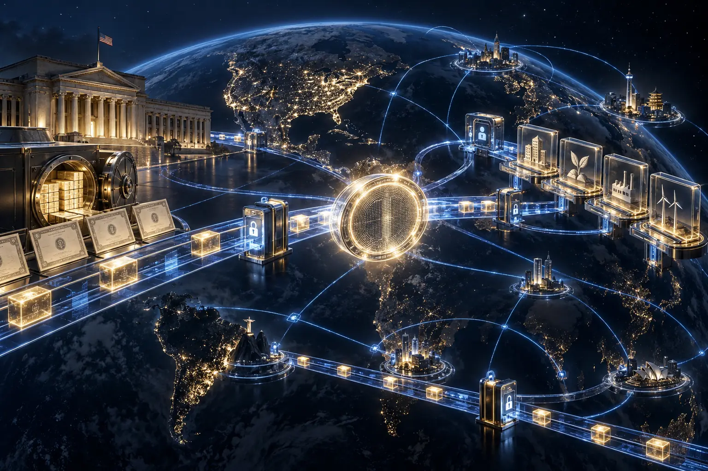
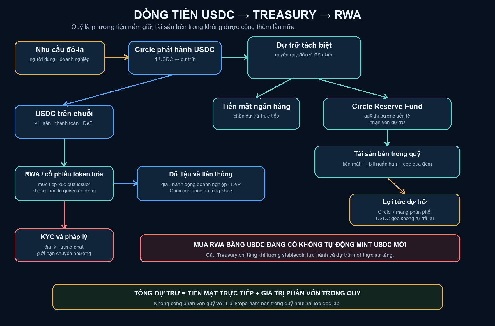
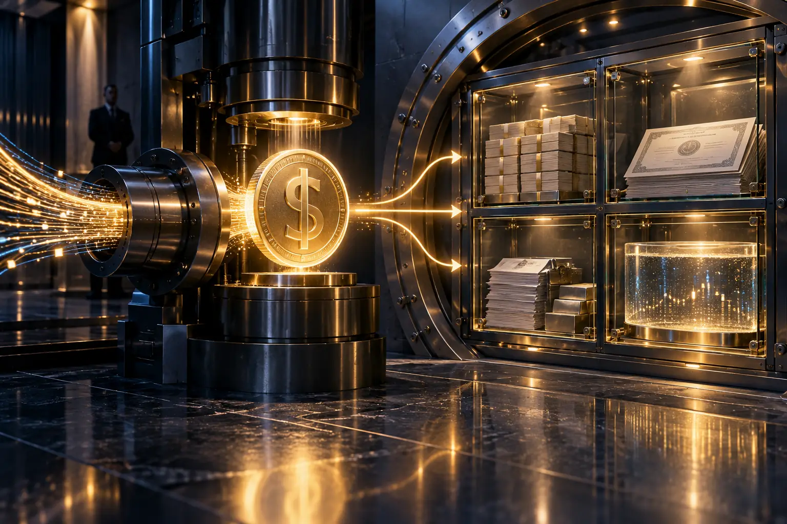

# Stablecoin — Cỗ Máy Xuất Khẩu Lạm Phát Và Phân Phối Nợ Mỹ

> Tất cả hình trong bài là minh họa khái niệm do trí tuệ nhân tạo tạo ra. Chúng không phải sơ đồ pháp lý hay báo cáo tài chính chính thức.
>
> *All images in this essay are AI-generated conceptual illustrations. They are not official legal diagrams or financial statements.*

**Stablecoin, tức đồng tiền mã hóa ổn định giá, thường được giới thiệu như một đồng đô-la chạy trên chuỗi khối. Nhưng ở quy mô hệ thống, nó còn là một đường ống mới: hút nhu cầu giữ đô-la từ khắp thế giới, đưa một phần dự trữ vào tiền mặt và nợ ngắn hạn của Mỹ, rồi phân phối lại khả năng thanh toán bằng đô-la đến bất kỳ nơi nào có ví và kết nối mạng.**

*Stablecoins are usually described as dollars running on blockchains. At system scale, they are also a new pipeline: drawing global demand for dollars, placing part of the reserves into cash and short-term US government debt, and redistributing dollar settlement capacity to anyone with a wallet and network access.*

Đó chưa phải cỗ máy in tiền mới. Circle không phải Cục Dự trữ Liên bang, còn việc phát hành USDC không giống việc ngân hàng trung ương tạo thêm tiền cơ sở. Nhưng stablecoin có thể làm một việc khác không kém phần chiến lược: mở rộng số người tự nguyện giữ nghĩa vụ bằng đô-la và mở rộng bể hấp thụ tài sản dự trữ định danh bằng đô-la.

*This is not a new money printer. Circle is not the Federal Reserve, and issuing USDC is not equivalent to creating new monetary base. Yet stablecoins may perform another strategic function: expanding the number of people who voluntarily hold dollar liabilities and enlarging the pool that absorbs dollar-denominated reserve assets.*

Luận đề của bài này không phải “stablecoin xóa nợ công Mỹ”. Luận đề là: stablecoin có thể toàn cầu hóa bảng cân đối đô-la, biến nhu cầu tự bảo vệ của người dân ngoài nước Mỹ thành một nguồn cầu mới cho đô-la, trái phiếu Kho bạc và hạ tầng tuân thủ của Mỹ.

*The thesis is not that stablecoins erase US public debt. It is that stablecoins may globalize the dollar balance sheet, turning the defensive demand of people outside the United States into additional demand for dollars, Treasuries, and US compliance infrastructure.*

---

## 1. Một USDC Được Sinh Ra Như Thế Nào? / How Is One USDC Created?

Khi một khách hàng đủ điều kiện đưa đô-la vào Circle Mint, Circle phát hành lượng USDC tương ứng. Theo trang minh bạch của Circle, phần lớn dự trữ USDC nằm trong Circle Reserve Fund, một quỹ thị trường tiền tệ chính phủ đăng ký theo quy định 2a-7 và do BlackRock quản lý. Quỹ có thể nắm tiền mặt, trái phiếu Kho bạc Mỹ ngắn hạn và các hợp đồng mua lại qua đêm được bảo đảm bằng trái phiếu Kho bạc. Phần còn lại chủ yếu là tiền mặt tại các ngân hàng lớn.

*When an eligible customer sends dollars into Circle Mint, Circle issues the corresponding amount of USDC. According to Circle’s transparency page, most USDC reserves are held in the Circle Reserve Fund, an SEC-registered Rule 2a-7 government money market fund managed by BlackRock. The fund may hold cash, short-term US Treasuries, and overnight repurchase agreements backed by Treasuries. The remainder is held mostly as bank cash.*

Báo cáo quý II năm 2026 của Circle ghi nhận khoảng 72,93 tỷ đô-la tiền gửi từ người nắm stablecoin và 73,16 tỷ đô-la tiền mặt cùng tài sản tương đương tiền được tách riêng vì lợi ích của người nắm stablecoin. Trong số đó, khoảng 61,9 tỷ đô-la nằm trong Circle Reserve Fund. Các con số này là những lớp trong cùng một cấu trúc dự trữ, không được cộng lại để tạo thành tổng mới.

*Circle’s second-quarter 2026 report recorded approximately $72.93 billion in deposits from stablecoin holders and $73.16 billion in cash and cash equivalents segregated for their benefit. About $61.9 billion of that amount was held in the Circle Reserve Fund. These figures describe layers of the same reserve structure and must not be added together as separate totals.*

Người giữ USDC thường chỉ nhìn thấy một mã thông báo. Phía sau mã thông báo là quan hệ ba tầng: Circle phát hành nghĩa vụ; tổ chức lưu ký và quỹ giữ tài sản; chuỗi khối ghi nhận quyền chuyển nhượng. Đó là tiền số về mặt trải nghiệm, nhưng là một cấu trúc tài chính tập trung ở tầng phát hành và dự trữ.

*The USDC holder sees a token. Behind it sits a three-layer relationship: Circle issues the liability; custodians and the reserve fund hold assets; and blockchains record transferability. It feels like digital money, but issuance and reserves remain centralized.*

---

## 2. Ai Hưởng Phần Lãi? / Who Receives the Yield?

Điều khoản USDC của Circle nói rõ mã thông báo không được thiết kế để tự tạo lợi tức cho người giữ. Circle có thể đặt dự trữ vào tài khoản sinh lãi hoặc công cụ tạo lợi suất, nhưng người giữ USDC không có quyền nhận phần lãi đó. Họ có quyền yêu cầu quy đổi theo điều kiện của hệ thống, không có quyền trực tiếp đối với từng trái phiếu nằm phía sau.

*Circle’s USDC terms state that the token is not designed to generate returns for holders. Circle may place reserves in interest-bearing accounts or yield-generating instruments, but USDC holders are not entitled to that interest. They possess a conditional redemption claim, not direct ownership of the Treasuries behind the token.*

Trong quý II năm 2026, Circle báo cáo 667,7 triệu đô-la thu nhập từ dự trữ; sáu tháng đầu năm đạt 1,32 tỷ đô-la. Cùng kỳ, chi phí phân phối và giao dịch lần lượt là 410,4 triệu và 815,8 triệu đô-la. Điều đó cho thấy phần lớn hoạt động kinh tế của stablecoin nằm ở khoảng chênh giữa lợi tức tài sản bảo chứng và chi phí đưa mã thông báo đến người dùng, sàn giao dịch, ví và đối tác.

*In the second quarter of 2026, Circle reported $667.7 million in reserve income; the first six months produced $1.32 billion. Distribution and transaction costs were $410.4 million and $815.8 million for the same periods. This shows that much of the stablecoin economy lies in the spread between reserve-asset yield and the cost of distributing the token through exchanges, wallets, and partners.*

Coinbase là đối tác phân phối quan trọng của USDC, nhưng chi phí phân phối tổng hợp không đồng nghĩa toàn bộ số tiền ấy được trả cho Coinbase. Nếu chưa mở đúng thỏa thuận và kỳ báo cáo, không nên biến một cơ chế chia sẻ phức tạp thành một tỷ lệ cố định. Điều chắc chắn hơn là người dùng tạo quy mô dự trữ, còn lợi tức dự trữ được ghi nhận ở tầng doanh nghiệp phát hành và mạng phân phối.

*Coinbase is an important USDC distribution partner, but aggregate distribution costs are not identical to payments made to Coinbase. Without the exact agreement and reporting period, a complex sharing mechanism should not be reduced to one fixed percentage. The safer conclusion is that users create reserve scale while reserve income is recognized at the issuer and distribution layers.*

---

## 3. Stablecoin Có Tài Trợ Nợ Công Mỹ Không? / Do Stablecoins Finance US Public Debt?

Câu trả lời là có thể, nhưng không phải theo cách trực tiếp thường được kể. Khi lượng USDC lưu hành tăng và dự trữ mới được phân bổ vào tín phiếu Kho bạc hoặc hợp đồng mua lại có thế chấp bằng chứng khoán Kho bạc Mỹ, nhu cầu đối với nợ ngắn hạn Mỹ tăng. Nguồn cầu bổ sung có thể hỗ trợ thanh khoản và giá trên thị trường, từ đó tác động đến chi phí vay ở biên.

*The answer is potentially yes, but not through the simplistic direct mechanism often described. When USDC circulation expands and new reserves are allocated to Treasury bills or Treasury-backed repo, demand for short-term US government debt rises. Additional demand may support market liquidity and pricing, influencing marginal borrowing costs.*

Nhưng mua trái phiếu trên thị trường thứ cấp không giống đưa tiền mới trực tiếp cho Bộ Tài chính tại phiên phát hành. Và tăng dự trữ stablecoin không luôn tạo ra nhu cầu ròng mới. Nếu người dùng bán một quỹ thị trường tiền tệ vốn đã nắm chứng khoán Kho bạc Mỹ để mua USDC, tài sản chỉ chuyển từ người trung gian này sang người trung gian khác. Tổng cầu toàn hệ thống có thể thay đổi rất ít.

*But purchasing Treasuries in the secondary market is not the same as delivering new proceeds directly to the Treasury at issuance. Nor does stablecoin reserve growth always create net new demand. If a user sells a money market fund that already owns Treasuries to acquire USDC, the asset may simply move from one intermediary to another while system-wide demand changes little.*

Vì vậy cần tách ba khái niệm: tổng lượng chứng khoán Kho bạc Mỹ do stablecoin nắm; phần tăng ròng của nhu cầu chứng khoán Kho bạc Mỹ do người dùng mới tạo ra; và lợi ích tài trợ mà chính phủ Mỹ thực sự nhận được. Gộp cả ba thành một con số sẽ phóng đại cỗ máy.

*Three concepts must therefore remain separate: the gross amount of Treasuries held by stablecoin structures, the net increase in Treasury demand caused by new users, and the funding benefit actually received by the US government. Combining all three into one figure exaggerates the machine.*

---

## 4. “Xuất Khẩu Lạm Phát” Đúng Đến Đâu? / How Accurate Is “Exporting Inflation”?

Khi người dân ở những nền kinh tế bất ổn chọn giữ stablecoin đô-la thay vì đồng nội tệ, họ mở rộng nhu cầu tiền tệ cho Mỹ mà không cần sống tại Mỹ. Nếu lượng đô-la và tài sản định danh bằng đô-la được giữ bên ngoài tăng, một phần tác động của chính sách tiền tệ Mỹ được phân tán qua mạng lưới người nắm toàn cầu.

*When people in unstable economies choose dollar stablecoins over local currency, they expand monetary demand for the United States without living there. If more dollars and dollar-denominated assets are held abroad, part of the effect of US monetary policy is distributed across a global network of holders.*

Nhưng “xuất khẩu lạm phát” không phải phép chia cơ học. Giá cả tại Mỹ, tỷ giá, nhu cầu tiền, dòng vốn và sức khỏe đồng nội tệ của mỗi nước tương tác với nhau. Một người Argentina giữ USDC có thể mất sức mua theo đô-la nhưng vẫn được lợi nếu peso mất giá nhanh hơn. Đồng đô-la mạnh cũng có thể bù một phần lạm phát khi đo bằng tiền địa phương.

*Yet “exporting inflation” is not mechanical arithmetic. US prices, exchange rates, money demand, capital flows, and the health of each local currency interact. An Argentine holding USDC may lose purchasing power in dollar terms while still benefiting if the peso depreciates faster. Dollar appreciation may also offset part of US inflation when measured in local currency.*

Cách nói chặt hơn là: stablecoin quốc tế hóa người gánh rủi ro sức mua của đồng đô-la. Nó mở rộng số người hưởng lợi khi đô-la mạnh và số người chịu thiệt khi đô-la suy yếu. Đây là sự toàn cầu hóa bảng cân đối Mỹ, không phải bằng chứng Mỹ có thể in tiền vô hạn mà không trả giá.

*The tighter formulation is that stablecoins internationalize exposure to the dollar’s purchasing power. They expand the population that benefits when the dollar strengthens and the population that bears losses when it weakens. This globalizes the US balance sheet; it does not prove that the United States can create money without limit or consequence.*

---

## 5. GENIUS Act — Đưa Stablecoin Vào Luật Mỹ / The GENIUS Act Brings Stablecoins Into US Law

GENIUS Act trở thành Luật Công 119-27 ngày 18 tháng 7 năm 2025. Luật yêu cầu tổ chức phát hành stablecoin thanh toán được cấp phép phải duy trì dự trữ có thể nhận diện với tỷ lệ ít nhất một–một. Tài sản cho phép gồm tiền mặt, số dư tại Cục Dự trữ Liên bang, tiền gửi ngân hàng đủ điều kiện, trái phiếu Kho bạc còn tối đa 93 ngày, hợp đồng mua lại qua đêm có thế chấp bằng chứng khoán Kho bạc Mỹ và quỹ thị trường tiền tệ chính phủ phù hợp.

*The GENIUS Act became Public Law 119-27 on July 18, 2025. It requires permitted payment-stablecoin issuers to maintain identifiable reserves at a ratio of at least one-to-one. Permitted assets include cash, Federal Reserve balances, eligible bank deposits, Treasuries with no more than 93 days remaining, overnight Treasury-backed repo, and qualifying government money market funds.*

Luật yêu cầu công khai chính sách quy đổi, phí, thành phần dự trữ hàng tháng và kiểm tra của công ty kiểm toán. Dự trữ nhìn chung không được cầm cố hay tái sử dụng ngoài một số ngoại lệ hẹp. Tổ chức phát hành được đặt vào khung chống rửa tiền, nhận diện khách hàng, giám sát giao dịch đáng ngờ, trừng phạt và khả năng chặn, đóng băng hoặc từ chối giao dịch theo lệnh hợp pháp.

*The law requires disclosure of redemption policies, fees, monthly reserve composition, and examination by a registered accounting firm. Reserves generally may not be pledged or reused outside narrow exceptions. Issuers enter a framework of anti-money-laundering controls, customer identification, suspicious-transaction monitoring, sanctions compliance, and the technical capability to block, freeze, or reject transactions under lawful orders.*

Điểm đáng chú ý nhất là luật cấm tổ chức phát hành trả lãi chỉ vì người dùng đang giữ stablecoin. Điều này bảo vệ ranh giới giữa mã thông báo thanh toán và sản phẩm đầu tư, đồng thời duy trì mô hình trong đó dự trữ sinh lợi ở tầng tổ chức còn mã thông báo gốc không tự chuyển lợi tức cho người nắm.

*Most revealingly, the law prohibits issuers from paying interest merely because a user holds the stablecoin. This preserves the boundary between payment tokens and investment products while maintaining a model in which reserves generate income at the institutional layer and the base token does not automatically pass yield to holders.*

Luật đã được ban hành nhưng phần vận hành phụ thuộc thời điểm có hiệu lực và quy định triển khai. Điều đó nghĩa là hướng đi đã rõ, còn chi tiết giám sát vẫn tiếp tục được hình thành.

*The law has been enacted, while its operation depends on the effective date and implementing regulations. The direction is clear even as supervisory detail continues to develop.*

---

## 6. CBDC Không Cần Xuất Hiện Đúng Tên / CBDC Functionality Without the CBDC Name

Một CBDC bán lẻ khiến công chúng lo rằng ngân hàng trung ương sẽ trực tiếp theo dõi và điều khiển từng đồng tiền. Stablecoin tư nhân tạo ra khoảng cách dễ chấp nhận hơn: Circle làm sản phẩm, sàn giao dịch phân phối, chuỗi khối vận chuyển, còn luật Mỹ đặt điều kiện dự trữ, nhận diện và cưỡng chế.

*A retail CBDC raises fears that a central bank will directly observe and control every unit of money. Private stablecoins create a more acceptable layer of distance: Circle builds the product, exchanges distribute it, blockchains transport it, and US law establishes reserve, identity, and enforcement conditions.*

USDC vẫn cho phép người dùng giữ mã thông báo trong ví riêng và chuyển trên chuỗi khối công khai. Nhưng Circle kiểm soát phát hành, quy đổi và hợp đồng. Điều khoản USDC yêu cầu tuân thủ trừng phạt, chống rửa tiền và nhận diện; người không đủ điều kiện mở Circle Mint không thể trực tiếp quy đổi với Circle; địa chỉ có thể bị chặn theo pháp luật.

*USDC still permits users to hold tokens in self-custodial wallets and move them on public blockchains. Yet Circle controls issuance, redemption, and the contract. USDC terms require sanctions, anti-money-laundering, and identity compliance; users ineligible for Circle Mint cannot redeem directly with Circle; and addresses may be blocked under law.*

Kết quả là một dạng chức năng giống CBDC nhưng được vận hành qua tổ chức tư nhân. Nhà nước không cần mở ví cho mọi người. Nó chỉ cần quản lý những đơn vị phát hành nằm ở cổ chai của hệ thống.

*The result resembles certain CBDC functions while operating through private institutions. The state need not open a wallet for every person. It can regulate the issuers positioned at the system’s narrowest chokepoints.*

---

## 7. Tài Sản Ngoài Chuỗi Và Cổ Phiếu Được Mã Hóa / RWA and Tokenized Stocks — The Asset Leg

Nếu stablecoin là chân tiền mặt của thị trường vốn trên chuỗi, tài sản ngoài chuỗi được mã hóa là chân tài sản. Trên Kraken, xStocks cho phép khách hàng đủ điều kiện mua các sản phẩm mã hóa gắn với cổ phiếu và quỹ ETF của Mỹ bằng tiền pháp định, tài sản mã hóa hoặc stablecoin, rồi rút sản phẩm đó về ví tương thích.

*If stablecoins are the cash leg of onchain capital markets, tokenized real-world assets are the asset leg. On Kraken, xStocks allow eligible clients to buy tokens linked to US stocks and ETFs using fiat, crypto assets, or stablecoins, then withdraw them to compatible wallets.*

Nhưng sản phẩm mã hóa gắn với cổ phiếu không nhất thiết là cổ phiếu. Tài liệu rủi ro của Kraken nói người giữ xStocks không sở hữu cổ phiếu cơ sở, không có quyền biểu quyết, không có yêu cầu pháp lý đối với công ty cơ sở và không có quyền đối với tài sản còn lại khi công ty thanh lý. Họ nắm công cụ do Backed Assets tại Jersey phát hành, tạo mức tiếp xúc kinh tế với giá cổ phiếu.

*But a stock token is not necessarily a share. Kraken’s risk disclosure says xStocks holders do not own the underlying equity, possess no voting rights, hold no legal claim against the underlying company, and have no residual claim in liquidation. They hold an instrument issued by Backed Assets in Jersey that provides economic exposure to the stock price.*

Quyền truy cập cũng không thật sự dành cho “mọi người”. xStocks loại trừ người cư trú tại Mỹ, Anh, Canada, Úc và các vùng bị trừng phạt; từng đối tác còn phải kiểm tra điều kiện. Giao dịch ngoài giờ của thị trường cơ sở không bảo đảm thanh khoản vô hạn: giá sản phẩm mã hóa vẫn chịu chênh lệch, phí, rủi ro tổ chức phát hành, lưu ký và khả năng quy đổi.

*Access is not literally universal. xStocks exclude residents of the United States, United Kingdom, Canada, Australia, and sanctioned jurisdictions; partner integrations remain subject to eligibility checks. Trading outside underlying market hours does not guarantee unlimited liquidity: the token remains exposed to spreads, fees, issuer risk, custody risk, and redemption constraints.*

Việc dùng USDC đang tồn tại để mua một sản phẩm mã hóa gắn với cổ phiếu chỉ chuyển USDC từ người này sang người khác. Nó không tự động làm Circle phát hành USDC mới hoặc mua thêm chứng khoán Kho bạc Mỹ. Cầu dự trữ chỉ tăng khi tổng lượng stablecoin lưu hành tăng và phần dự trữ mới thực sự được phân bổ vào tài sản Kho bạc.

*Using existing USDC to buy a stock token merely transfers USDC from one holder to another. It does not automatically cause Circle to issue new USDC or buy additional Treasuries. Reserve demand rises only when total stablecoin circulation expands and new reserves are actually allocated into Treasury assets.*

---

## 8. Chainlink — Xiềng Xích Của Thị Trường Vốn Mới / Chainlink — The Chain of the New Capital Market

Thị trường tài sản mã hóa cần nhiều hơn việc tạo mã thông báo. Cổ phiếu cần giá tham chiếu, hành động doanh nghiệp, dữ liệu định giá, điều kiện tuân thủ và khả năng di chuyển giữa nhiều mạng. Chainlink cung cấp các công cụ dữ liệu, thanh toán giao–nhận, tự động hóa tuân thủ và giao thức liên thông chuỗi để giải quyết những khoảng trống ấy.

*Tokenized markets require more than creating tokens. Equities need reference prices, corporate actions, valuation data, compliance conditions, and mobility across networks. Chainlink offers data services, delivery-versus-payment settlement, compliance automation, and cross-chain interoperability to address these gaps.*

Các thử nghiệm và triển khai được Chainlink công bố cho thấy vai trò đó đang đi vào thị trường vốn: dữ liệu chứng khoán được mã hóa tại sàn 21X của châu Âu, giao dịch quỹ được mã hóa của UBS, quy trình giao–nhận giữa Kinexys của J.P. Morgan và Ondo, cùng các dự án dữ liệu với DTCC.

*Chainlink’s published pilots and deployments show that role entering capital markets: tokenized securities data for Europe’s 21X exchange, UBS tokenized-fund workflows, delivery-versus-payment between J.P. Morgan’s Kinexys and Ondo, and data projects involving DTCC.*

Vì thế Chainlink có thể là “mắt xích” kỹ thuật, nhưng cũng là “xiềng xích” thể chế. Cùng một lớp giúp tài sản di chuyển giữa chuỗi cũng có thể mang theo danh tính, danh sách trừng phạt, giới hạn giao dịch và điều kiện quyền sở hữu. Tài sản trở nên linh hoạt hơn nhưng không nhất thiết tự do hơn. “Xiềng xích” ở đây là một ẩn dụ biên tập về sự phụ thuộc vào hạ tầng và luật lệ, không phải mô tả Chainlink như cơ quan sở hữu hay đóng băng mọi tài sản.

*Chainlink may be the technical link, but it can also become an institutional chain. The same layer that moves assets across networks may carry identity, sanctions lists, transaction limits, and ownership conditions. Assets become more mobile without necessarily becoming more free. “Chain” here is an editorial metaphor for infrastructural and legal dependence, not a claim that Chainlink owns or freezes every asset.*

Điều này không có nghĩa mọi tài sản được mã hóa đều dùng Chainlink, hay việc ứng dụng công nghệ chắc chắn chuyển thành giá trị cho đồng LINK. Chainlink là một ứng viên hạ tầng quan trọng, không phải định mệnh duy nhất của thị trường.

*This does not mean every tokenized asset uses Chainlink, or that technical adoption necessarily translates into value for the LINK token. Chainlink is an important infrastructure candidate, not the market’s only destiny.*

---

## 9. Cỗ Máy Toàn Cầu Hóa Đồng Đô-La / The Machine That Globalizes the Dollar

Khi ghép các lớp lại, hệ thống hiện ra:

*When the layers are assembled, the system becomes visible:*

> **Nhu cầu giữ đô-la → stablecoin → dự trữ tiền mặt/chứng khoán Kho bạc Mỹ → thanh toán trên chuỗi → mua tài sản được mã hóa → dữ liệu và liên thông → xác minh danh tính khách hàng và khả năng cưỡng chế.**
>
> *Demand for dollars → stablecoins → cash/Treasury reserves → onchain settlement → tokenized assets → data and interoperability → KYC and enforceability.*

Người dùng tại một nước có đồng tiền yếu không cần quan tâm nợ công Mỹ. Họ chỉ muốn giữ sức mua. Doanh nghiệp không cần tin vào địa chính trị Mỹ. Họ chỉ muốn thanh toán nhanh. Nhà đầu tư không cần mở tài khoản môi giới truyền thống. Họ chỉ muốn tiếp cận tài sản Mỹ từ chiếc ví đang có.

*A user in a country with a weak currency does not need to care about US public debt. They want to preserve purchasing power. A business does not need to believe in American geopolitics. It wants faster settlement. An investor may not want a traditional brokerage account. They want access to US assets from the wallet they already use.*

Chính những động cơ cá nhân hợp lý ấy có thể tạo thành kết quả hệ thống: nhu cầu đô-la mở rộng, dự trữ stablecoin tăng, thị trường chứng khoán Kho bạc Mỹ có thêm một nhóm trung gian, tài sản Mỹ được phân phối trên chuỗi và luật Mỹ đi theo đồng tiền ra toàn cầu.

*Those individually rational motives may combine into a systemic outcome: broader dollar demand, larger stablecoin reserves, another class of Treasury intermediaries, onchain distribution of US assets, and US legal rules travelling with the currency.*

Mỹ không cần buộc cả thế giới mua nợ của mình. Cách mạnh hơn là khiến đồng đô-la trở thành công cụ phòng thủ thuận tiện nhất, rồi để thị trường tư nhân đặt trái phiếu Kho bạc phía sau công cụ ấy.

*The United States need not force the world to purchase its debt. A more powerful strategy is to make the dollar the most convenient defensive instrument, then allow private markets to place Treasuries behind that instrument.*

---

## 10. Giới Hạn Của Cỗ Máy / The Machine Has Limits

Bể hấp thụ không vô hạn. Mỹ vẫn phải trả lãi, tái cấp vốn và giữ niềm tin vào đồng tiền. Nếu nợ tăng nhanh hơn nhu cầu đô-la toàn cầu, chi phí sẽ xuất hiện qua lãi suất, mất giá tiền tệ, lạm phát, kiềm chế tài chính hoặc cắt giảm chi tiêu.

*The absorption pool is not infinite. The United States must still pay interest, refinance debt, and preserve confidence in the currency. If debt grows faster than global dollar demand, costs reappear through rates, currency debasement, inflation, financial repression, or spending cuts.*

Stablecoin cũng mang rủi ro riêng: người dùng đổ xô quy đổi; tài sản dự trữ mất thanh khoản; ngân hàng lưu ký gặp sự cố; hợp đồng bị tấn công; tổ chức phát hành đóng băng địa chỉ; quy định thay đổi; hoặc sản phẩm mã hóa giao dịch ngoài giờ nhưng không tìm được thanh khoản tương ứng từ tài sản cơ sở.

*Stablecoins carry their own risks: redemption runs, reserve illiquidity, custodian failure, contract exploits, issuer freezes, regulatory change, or tokens trading after hours without corresponding liquidity in the underlying asset.*

Cỗ máy vì thế không phải phép màu xóa nợ. Nó là một nâng cấp phân phối. Nó giúp đồng đô-la đi xa hơn, nhanh hơn và bám sâu hơn vào hạ tầng số của thế giới. Sức mạnh của nó đến từ quy mô và sự tiện dụng; giới hạn của nó vẫn là lòng tin.

*The machine is therefore not magic that erases debt. It is a distribution upgrade. It allows the dollar to travel farther, faster, and deeper into the world’s digital infrastructure. Its power comes from scale and convenience; its ultimate limit remains trust.*

**Stablecoin không làm nước Mỹ hết nợ. Nó làm nhiều người hơn trên thế giới tự nguyện bước vào bảng cân đối của nước Mỹ.**

*Stablecoins do not make US debt disappear. They make more people around the world voluntarily step onto the American balance sheet.*

---

## Nguồn Chính / Key Sources

1. Circle, [Transparency & Stability](https://www.circle.com/transparency)
2. Circle, [USDC Terms](https://www.circle.com/legal/usdc-terms)
3. Circle Internet Group, [Q2 2026 Form 10-Q](https://d18rn0p25nwr6d.cloudfront.net/CIK-0001876042/ea208256-f5a3-44b0-b51e-845285336f68.pdf)
4. U.S. Public Law 119-27, [GENIUS Act](https://www.govinfo.gov/content/pkg/PLAW-119publ27/pdf/PLAW-119publ27.pdf)
5. U.S. Treasury / FSOC, [2025 Annual Report](https://home.treasury.gov/news/press-releases/sb0334)
6. Kraken, [xStocks Risk Disclosure](https://www.kraken.com/legal/xstocks)
7. Chainlink, [Tokenized Assets](https://chain.link/use-cases/tokenized-assets)
8. Chainlink, [Cross-Chain Interoperability Protocol](https://chain.link/cross-chain)
9. [[Gen Z và CBDC - Programmable Money Psychology]]
10. [[Chainlink - Mắt Xích Của Tokenized World]]
11. [[Cantillon Effect - Ai Đứng Gần Vòi Tiền]]
12. [[MOC - Financial Sovereignty]]
