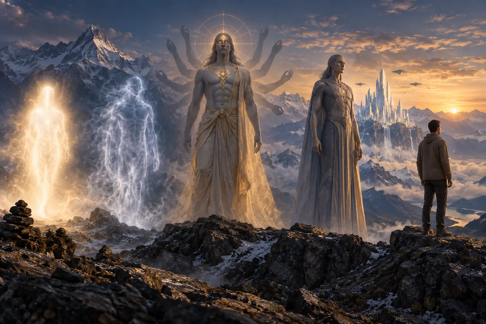
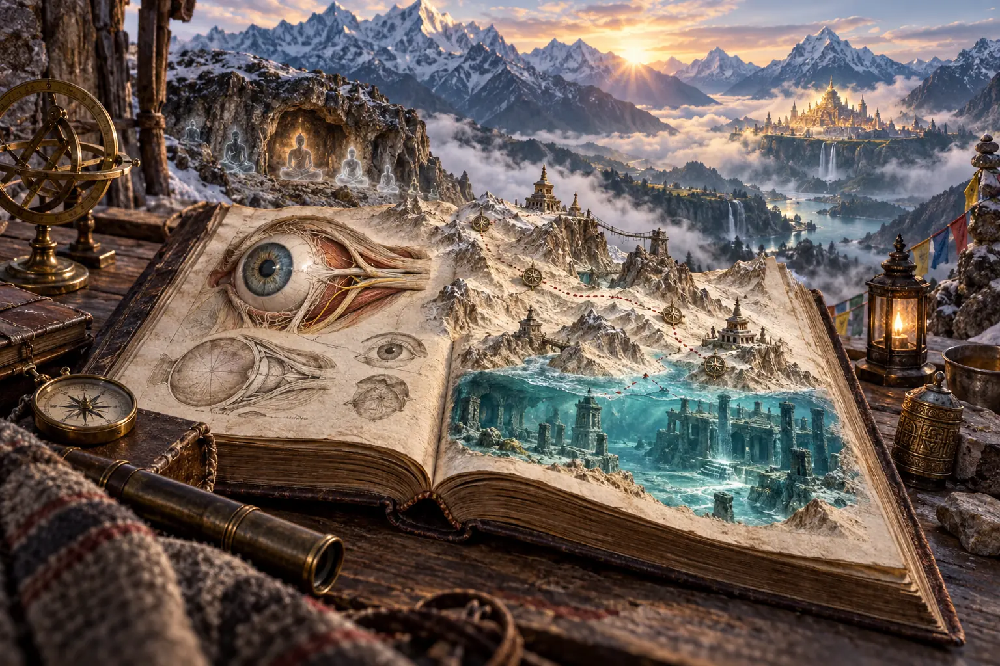
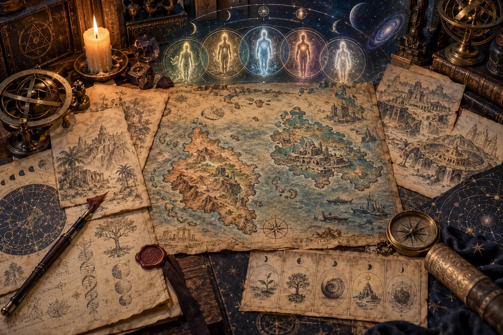
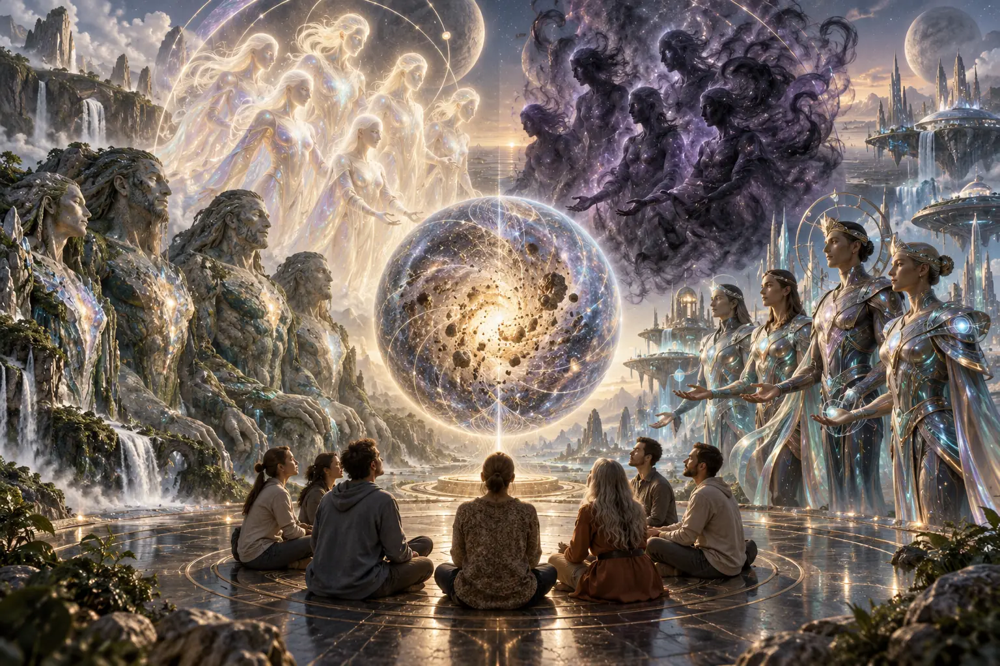
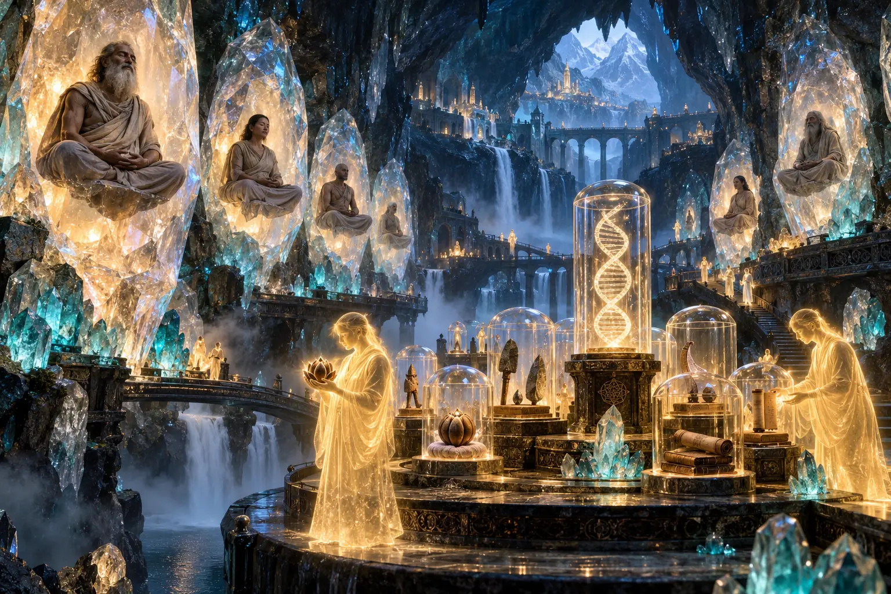
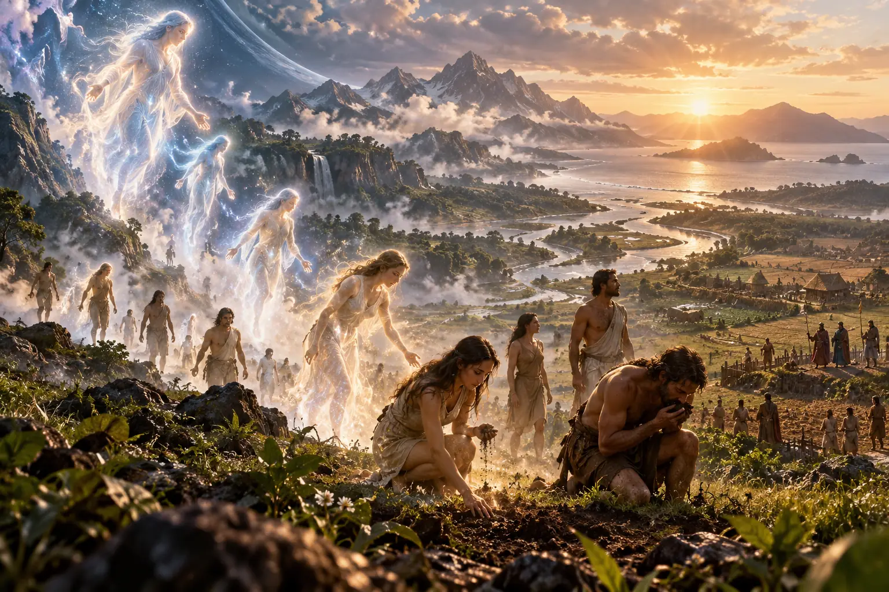
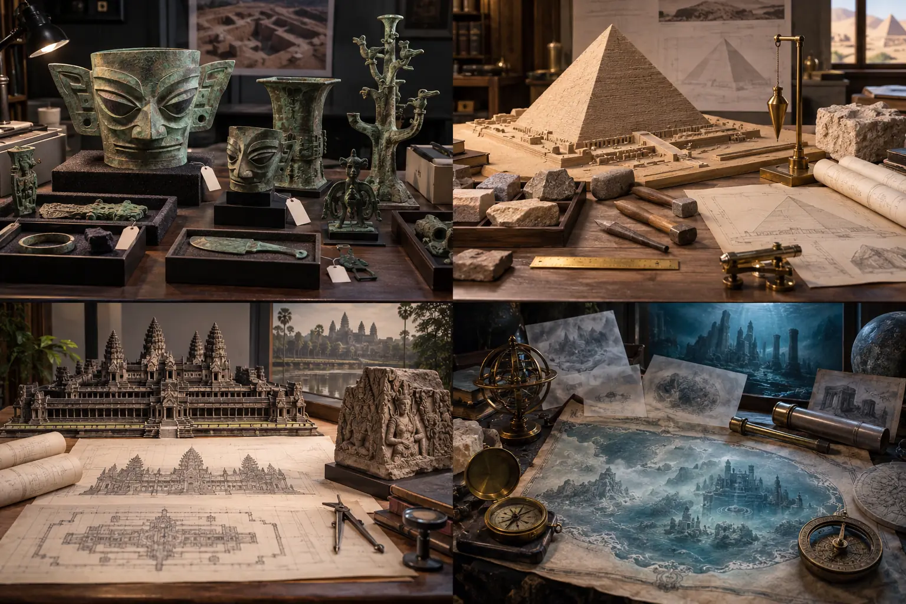
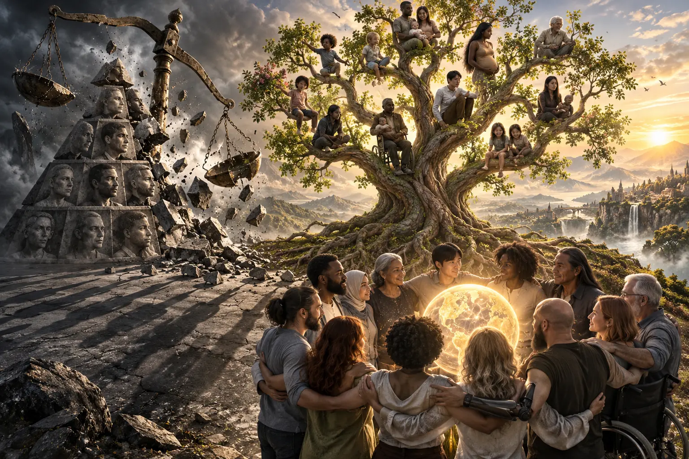
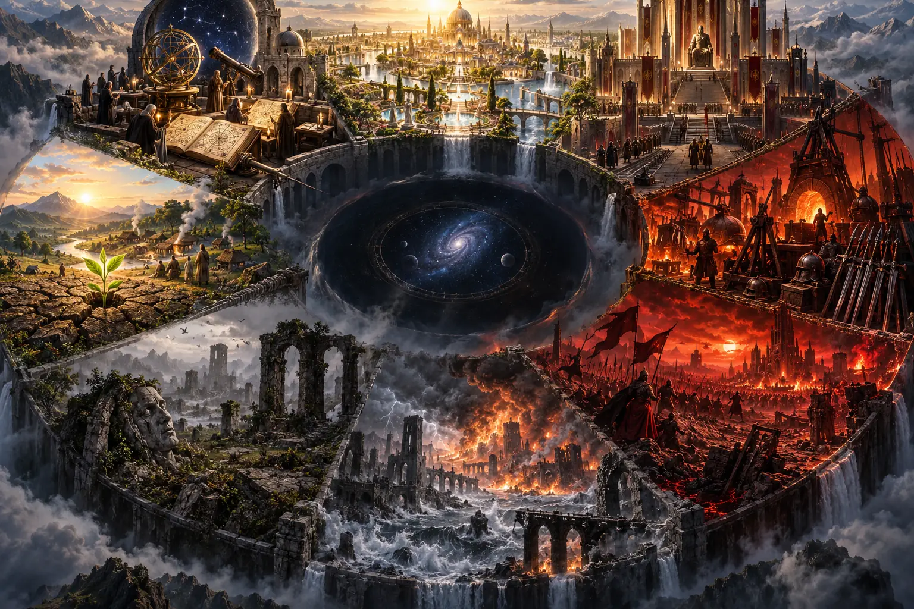
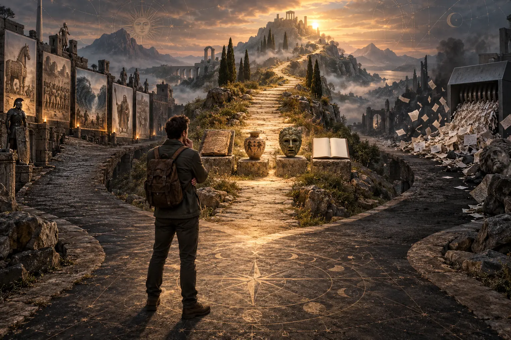

# Muldashev Và Năm Nhân Loại — Lịch Sử Bị Quên Hay Bản Đồ Huyền Học?

> Tất cả hình trong bài là minh họa khái niệm do trí tuệ nhân tạo tạo ra. Chúng không phải ảnh khảo cổ hay bằng chứng về hình thái của các chủng người được mô tả.
>
> *All images in this essay are AI-generated conceptual illustrations. They are neither archaeological photographs nor evidence of the human forms described.*

**Ernst Muldashev kể một lịch sử nhân loại hoàn toàn khác với đường thẳng quen thuộc. Con người không khởi đầu như động vật nguyên thủy rồi tiến dần lên văn minh. Trong bản đồ của ông, ý thức xuất hiện trước, cơ thể vật chất xuất hiện sau. Nhân loại từng đi qua những hình thái tinh tế, khổng lồ và có năng lực tâm linh, rồi dần cô đặc, đánh mất ký ức và trở thành con người hiện đại.**

*Ernst Muldashev tells a history of humanity radically different from the familiar ascending line. Humanity does not begin as a primitive animal and gradually rise toward civilization. In his map, consciousness comes first and dense physical embodiment comes later. Humanity passes through subtle, gigantic, psychically capable forms, then gradually condenses, loses memory, and becomes modern humankind.*

Bản đồ ấy vừa hấp dẫn vừa nguy hiểm. Nó hấp dẫn vì nối được nhiều mô-típ cổ: chúng sinh ánh sáng rơi xuống vật chất, người khổng lồ, con mắt thứ ba, lục địa chìm, đại hồng thủy, hiền nhân vào hang sâu và một nền văn minh bị chính quyền năng của mình hủy diệt. Nó nguy hiểm vì nếu kể bằng giọng quá chắc, người đọc dễ nhầm một hệ tổng hợp huyền học hiện đại với biên niên sử đã được khảo cổ xác nhận.

*The map is both compelling and dangerous. It is compelling because it joins many ancient motifs: luminous beings descending into matter, giants, the third eye, sunken continents, global floods, sages entering deep caves, and a civilization destroyed by its own power. It is dangerous because, when narrated too confidently, a modern esoteric synthesis can be mistaken for an archaeologically verified chronicle.*

Bài này không bắt người đọc chọn giữa Darwin và Muldashev. Nó đặt một câu hỏi khác: Muldashev đã ghép những truyền thống nào thành bản đồ của mình, bản đồ đó giúp ta nhìn thấy điều gì, và ở đâu nó vượt khỏi giới hạn của bằng chứng?

*This essay does not force a choice between Darwin and Muldashev. It asks a different question: which traditions did Muldashev weave into his map, what does that map allow us to see, and where does it exceed the limits of evidence?*

---

## 1. Cuốn Sách Thực Sự Nói Về Điều Gì? / What Is the Book Actually About?

*Where Do We Come From?* của Ernst Muldashev là một cuốn sách gần năm trăm trang, kết hợp du ký, phỏng vấn, suy luận y học, huyền học và lịch sử thay thế. Mục lục công khai cho thấy các chương đi từ “đôi mắt trung bình về mặt thống kê”, hình mắt trên đền Tây Tạng, những gì các lama Nepal và Tây Tạng kể, đến Lemuria, Atlantis, các hang nhập định, quỹ di truyền nhân loại, Shambhala, lịch sử nhân loại trên Trái Đất và tiến hóa thoái bộ.

*Ernst Muldashev’s Where Do We Come From? is a nearly five-hundred-page work combining travel narrative, interviews, medical speculation, esotericism, and alternative history. Its public table of contents moves from the “statistically average eye,” Tibetan temple eyes, and what Nepalese and Tibetan lamas allegedly said, to Lemuria, Atlantis, samadhi caves, the human gene pool, Shambhala, the history of humanity on Earth, and regressive evolution.*

Muldashev là bác sĩ nhãn khoa. Vì vậy ông cố dựng một cây cầu giữa chuyên môn của mình và huyền sử: đo hình thái mắt của nhiều nhóm người, tìm một hình mắt “trung bình”, rồi so sánh nó với hình tượng trên đền chùa. Từ đó ông suy luận về trung tâm phát tán nhân loại, những chủng người cổ và các sinh thể đang bảo tồn trong trạng thái nhập định.

*Muldashev is an ophthalmologist. He therefore attempts to build a bridge between his profession and sacred history: measuring eye forms across populations, deriving a “statistical average,” and comparing it with temple imagery. From there he speculates about a center of human dispersal, ancient humanities, and beings preserved in meditative suspension.*

Cách làm ấy không phải khảo cổ học hay di truyền học theo chuẩn thông thường. Nó là một phương pháp diễn giải liên ngành rất cá nhân: số đo cơ thể, lời kể truyền miệng, hình tượng tôn giáo và trực giác được đặt trên cùng một mặt phẳng. Điều cần giữ là danh tính thật của phương pháp. Đây là cuộc điều tra huyền học của một bác sĩ, không phải kết luận đồng thuận của khoa học về nguồn gốc loài người.

*This is not archaeology or population genetics in the conventional sense. It is a highly personal interpretive method that places bodily measurements, oral testimony, sacred imagery, and intuition on the same plane. The method must be named honestly. This is a physician’s esoteric investigation, not a scientific consensus on human origins.*

---

## 2. Dấu Vết Thông Thiên Học Trong Bản Đồ Muldashev / The Theosophical Signature in Muldashev’s Map

Chuỗi người tinh tế đầu tiên, chủng thứ hai sinh ra bằng nảy chồi, Lemuria là chủng thứ ba, Atlantis là chủng thứ tư và nhân loại hiện nay là chủng thứ năm gần giống rõ rệt với hệ “các chủng tộc gốc” trong *The Secret Doctrine* của Helena Blavatsky.

*The sequence of subtle first humanity, a second race produced by budding, Lemuria as the third race, Atlantis as the fourth, and present humanity as the fifth closely resembles the “root race” system in Helena Blavatsky’s The Secret Doctrine.*

Văn bản Thông thiên học xuất bản năm 1888 mô tả những “cái bóng” không xương, những hình thể dần có xương, sự phân chia giới tính trong chủng thứ ba, con mắt thứ ba ngừng hoạt động, chủng thứ tư xây những thành phố khổng lồ rồi bị nước hủy diệt, và chủng thứ năm sống sót từ dòng giống còn lại. Những mô-típ này không chỉ tương đồng chung chung; chúng tạo thành cùng một bộ xương truyện.

*The Theosophical text published in 1888 describes boneless “shadows,” forms gradually acquiring bones, the separation of sexes in the third race, the closing of the third eye, a proud fourth race that built enormous cities and was destroyed by water, and a surviving fifth race descending from what remained. These are not merely vague similarities; they form the same narrative skeleton.*

Điều đó không chứng minh Muldashev sao chép Blavatsky theo từng câu. Mục lục công khai của ông không đủ để xác lập đường vay mượn trực tiếp. Cách nói chính xác hơn là: hệ thống Muldashev nằm trong cùng gia đình tư tưởng Thông thiên học và mở rộng nó bằng Tây Tạng, nhãn khoa, hang nhập định, Shambhala và những chuyến thám hiểm của riêng ông.

*This does not prove that Muldashev copied Blavatsky sentence by sentence. His public table of contents is insufficient to establish direct borrowing. The more precise statement is that Muldashev’s system belongs to the same Theosophical family and extends it through Tibet, ophthalmology, samadhi caves, Shambhala, and his own expedition narratives.*

Từ “chủng tộc” trong hệ này cũng không tương đương đơn giản với chủng tộc sinh học hiện đại. Nó chỉ một giai đoạn vũ trụ–tâm linh của nhân loại. Tuy nhiên, ngôn ngữ phân cấp và đặc biệt chữ “Aryan” mang theo lịch sử tư tưởng chủng tộc của thế kỷ XIX. Bài đọc nghiêm túc phải nhìn thẳng vào di sản đó thay vì dùng thuật ngữ như một nhãn vô hại.

*The word “race” in this system does not map neatly onto modern biological race. It denotes a cosmic-spiritual stage of humanity. Yet its hierarchy, and especially the term “Aryan,” carries the racial history of the nineteenth century. A serious reading must confront that inheritance rather than treating the term as harmless.*

---

## 3. Năm Nhân Loại Trong Bản Đồ Muldashev / The Five Humanities in Muldashev’s Map

### Nhân Loại Thứ Nhất — Hình Thái Ánh Sáng / First Humanity — Luminous Form

Trong bản tóm lược lưu hành về hệ Muldashev, con người đầu tiên chưa có thân thể vật chất đặc. Họ lớn, tinh tế, có thể xuyên qua vật cản và liên hệ trực tiếp với thế giới vô hình. Đây là ấu thơ của nhân loại khi ý thức chưa bị khóa chặt trong vật chất.

*In circulating summaries of Muldashev’s system, the first humanity does not yet possess a dense physical body. These beings are immense, subtle, able to pass through barriers, and directly connected to an invisible world. This is humanity’s infancy, before consciousness becomes tightly enclosed in matter.*

### Nhân Loại Thứ Hai — Hình Thái Bóng Ma / Second Humanity — Phantom Form

Chủng thứ hai đã đặc hơn nhưng vẫn gần thế giới tinh tế. Một con mắt giúp họ thấy cõi vô hình; họ được mô tả có khả năng dùng năng lượng tác động lên vật chất và trọng lực. Đây là giai đoạn chuyển tiếp: tinh thần bắt đầu mặc lấy thân thể nhưng chưa bị thân thể thống trị hoàn toàn.

*The second humanity is denser yet still close to the subtle world. A single eye allows perception of the invisible realm, and these beings are described as using energy to influence matter and gravity. This is a transitional stage: spirit begins to wear a body but is not yet ruled by embodiment.*

### Nhân Loại Thứ Ba — Lemuria / Third Humanity — Lemuria

Người Lemuria đầu tiên được mô tả như những sinh thể khổng lồ, nhiều tay, nhiều mặt và còn con mắt thứ ba. Về sau họ thu nhỏ, phân hóa giới tính, xây thành phố, phát triển phương tiện bay, chữa bệnh bằng năng lượng và kéo dài tuổi thọ. Lemuria tượng trưng cho thời đại tri thức còn gắn với đời sống tinh thần.

*Early Lemurians are described as gigantic beings with multiple arms, faces, and an active third eye. Later they become smaller, differentiate sexually, build cities, develop flying craft, heal through energy, and live for extraordinary spans. Lemuria represents an age in which knowledge remains joined to spiritual life.*

### Nhân Loại Thứ Tư — Atlantis / Fourth Humanity — Atlantis

Atlantis kế thừa tri thức Lemuria nhưng đẩy mạnh khoa học, quyền lực tâm trí, thần giao cách cảm, kỹ thuật năng lượng và phương tiện bay. Khi tri thức chuyển từ chữa lành sang thống trị, các phe nhóm xuất hiện, vũ khí được chế tạo và chiến tranh kéo dài. Đại thảm họa không còn là tai nạn bên ngoài; nó là hình thức vật chất của sự suy đồi bên trong.

*Atlantis inherits Lemurian knowledge but intensifies science, psychic power, telepathy, energy technology, and aerial craft. When knowledge shifts from healing toward domination, factions emerge, weapons are built, and war becomes prolonged. Catastrophe is no longer merely external; it becomes the material form of inner corruption.*

### Nhân Loại Thứ Năm — Con Người Hiện Nay / Fifth Humanity — Present Humankind

Con người hiện đại nhỏ hơn, thích nghi tốt với vật chất và lao động hiệu quả, nhưng mất phần lớn năng lực trực giác và khả năng tiếp cận tri thức tinh tế. Sau các thảm họa, công nghệ cũ biến mất, ký ức tập thể tan vỡ và nhân loại trải qua điều Muldashev gọi là tiến hóa thoái bộ: một loài không chỉ có thể tiến lên mà còn có thể quên, thô hóa và rơi xuống.

*Modern humanity is smaller, better adapted to matter, and more efficient in labor, yet has lost much of its intuitive capacity and access to subtle knowledge. After catastrophes, older technologies disappear, collective memory fragments, and humanity undergoes what Muldashev calls regressive evolution: a species can not only advance but also forget, coarsen, and fall.*

---

## 4. Quỹ Gene Nhân Loại Và Những Người Đang Ngủ / The Human Gene Pool and the Sleeping Ones

Một trong những ý tưởng đặc trưng nhất của Muldashev là “quỹ di truyền nhân loại”: các cá thể thuộc những nền văn minh trước vẫn được bảo tồn trong trạng thái nhập định sâu bên trong các hang động. Họ không chết theo nghĩa thông thường; cơ thể và ý thức được giữ như một bản sao lưu để phục hồi nhân loại sau thảm họa toàn cầu.

*One of Muldashev’s most distinctive ideas is the “human gene pool”: individuals from earlier civilizations preserved in profound meditative suspension inside hidden caves. They are not dead in the ordinary sense; body and consciousness are retained as a backup from which humanity may be restored after global catastrophe.*

Shambhala và Agharti trong bản đồ này không chỉ là vương quốc bí mật. Chúng là kho lưu trữ tri thức, máy móc, sinh thể và ký ức của các chu kỳ trước. Những người tiến bộ nhất không cố cứu mọi cấu trúc đã suy đồi. Họ rút lui, giữ hạt giống và chờ chu kỳ mới.

*Shambhala and Agharti in this map are not merely secret kingdoms. They are archives of knowledge, machines, beings, and memories from previous cycles. The most advanced do not attempt to preserve every corrupted structure. They withdraw, keep the seed, and wait for a new cycle.*

Không có bằng chứng khảo cổ công khai về một quỹ di truyền như vậy. Nhưng ở tầng biểu tượng, ý tưởng này rất hiện đại. Hạt giống, hầm dữ liệu, kho vật liệu di truyền, kho lưu trữ tận thế và các cơ sở dự phòng đều xuất phát từ cùng một trực giác: văn minh biết mình hữu hạn nên tìm cách gửi một phần bản thân qua lần sụp đổ tiếp theo.

*There is no public archaeological evidence for such a gene pool. Yet symbolically the idea is strikingly modern. Seed vaults, data bunkers, genetic repositories, doomsday archives, and redundant systems all arise from the same intuition: civilization knows it is finite and attempts to send part of itself through the next collapse.*

---

## 5. Aggañña Sutta Và Mô-Típ Ý Thức Cô Đặc / The Aggañña Sutta and the Motif of Condensing Consciousness

Trong *Aggañña Sutta*, các chúng sinh sáng chói xuất hiện sau một chu kỳ thế giới, sống bằng hỷ lạc và tự phát ánh sáng. Khi họ nếm vị đất, tham muốn tăng lên, thân thể trở nên thô nặng, ánh sáng mất dần, giới tính và địa vị xã hội xuất hiện. Đây là một câu chuyện về sự cô đặc: từ tự đủ đến ham muốn, từ sáng chói đến nặng nề, từ cộng đồng chưa phân chia đến sở hữu và giai cấp.

*In the Aggañña Sutta, luminous beings appear after a world cycle, feeding on rapture and shining by their own light. As they taste the savory earth, desire grows, bodies become coarse, radiance fades, and sex and social hierarchy emerge. It is a story of condensation: from self-sufficiency to craving, from luminosity to heaviness, from an undivided community to property and class.*

Sự tương đồng với Muldashev nằm ở hướng chuyển động: ý thức tinh tế trở thành vật chất đặc và suy giảm năng lực. Nhưng kinh không mô tả Lemuria bốn tay, Atlantis có phi thuyền, hang bảo tồn vật liệu di truyền hay hệ năm chủng người của Thông thiên học. Mô-típ Phật giáo tạo một nhịp cộng hưởng; nó không xác nhận toàn bộ biên niên sử Muldashev.

*The resemblance to Muldashev lies in the direction of movement: subtle consciousness becomes dense matter and loses capacity. Yet the discourse does not describe four-armed Lemurians, Atlantean aircraft, gene-preservation caves, or a Theosophical five-race system. The Buddhist motif creates resonance; it does not authenticate Muldashev’s entire chronology.*

Sự khác biệt về mục tiêu cũng quan trọng. Muldashev tìm nguồn gốc bị quên của nhân loại. *Aggañña Sutta* dùng câu chuyện hình thành xã hội để phá niềm kiêu hãnh giai cấp và cho thấy đạo đức, không phải huyết thống, làm nên phẩm giá. Một văn bản hỏi “chúng ta từng là ai”; văn bản kia hỏi “vì sao ta bám vào thân phận hiện tại”.

*The difference in purpose is equally important. Muldashev searches for humanity’s forgotten origin. The Aggañña Sutta uses social origins to dismantle caste pride and show that conduct, not lineage, determines dignity. One text asks, “What were we?” The other asks, “Why do we cling to who we are now?”*

---

## 6. Khi Huyền Sử Đứng Cạnh Khảo Cổ / When Sacred History Meets Archaeology

Một sai lầm phổ biến là đặt Lemuria, Atlantis, Sanxingdui, Giza, Angkor Wat, Kailasa và Vạn Lý Trường Thành vào cùng một danh sách “văn minh bị che giấu”. Chúng không có cùng trạng thái bằng chứng.

*A common mistake is to place Lemuria, Atlantis, Sanxingdui, Giza, Angkor Wat, Kailasa, and the Great Wall in a single list of “hidden civilizations.” They do not possess the same evidentiary status.*

Sanxingdui là một nền văn hóa khảo cổ thật của thời đồ đồng với di vật, hố tế lễ và niên đại nghiên cứu được. Angkor Wat là công trình Khmer thế kỷ XII. Đại kim tự tháp Giza thuộc Cổ Vương quốc Ai Cập, khoảng thiên niên kỷ thứ ba trước Công nguyên. Những địa điểm này vẫn chứa câu hỏi lớn về tổ chức, kỹ thuật và ý nghĩa, nhưng không cần bị đẩy về 80.000 năm trước mới trở nên phi thường.

*Sanxingdui is a real Bronze Age archaeological culture with excavated objects, sacrificial pits, and studied chronology. Angkor Wat is a twelfth-century Khmer monument. The Great Pyramid belongs to Egypt’s Old Kingdom in the third millennium BCE. These sites still raise profound questions of organization, engineering, and meaning, but they do not need to be moved eighty thousand years into the past in order to remain extraordinary.*

Lemuria bắt đầu như một giả thuyết địa lý thế kỷ XIX nhằm giải thích sự phân bố của loài vượn cáo trước khi kiến tạo mảng thay đổi khoa học địa chất. Atlantis đến từ Plato rồi được nhiều truyền thống huyền học mở rộng. Chúng là những vùng huyền sử cần phương pháp đọc khác với một địa điểm đã khai quật.

*Lemuria began as a nineteenth-century geographical hypothesis meant to explain the distribution of lemurs before plate tectonics transformed geology. Atlantis comes from Plato and was later expanded by many esoteric traditions. These belong to sacred and speculative history and require a different method from an excavated site.*

Câu “người hiện đại không thể xây” cũng quá mạnh. Con người hiện đại có thể tái tạo nhiều công trình nếu chấp nhận chi phí, thời gian và lao động tương ứng. Câu hỏi thú vị hơn là người cổ đã tổ chức tri thức, quyền lực, nghi lễ và lao động như thế nào để biến một dự án vượt nhiều thế hệ thành hiện thực.

*The claim that modern people “could not build” such monuments is also too strong. Modern societies could reproduce many of them if they accepted comparable cost, time, and labor. The more interesting question is how ancient societies organized knowledge, authority, ritual, and work to make multigenerational projects possible.*

---

## 7. “Aryan” Và Cái Bóng Của Hệ Thống Phân Cấp / “Aryan” and the Shadow of Hierarchy

Trong ngôn ngữ Thông thiên học, “Aryan” là tên của chủng tộc gốc thứ năm, tức nhân loại hiện nay. Dù hệ thống tuyên bố các chủng tộc là giai đoạn tâm linh hơn là nhóm sinh học hiện đại, nó vẫn được sắp thành thứ bậc, gắn phẩm chất và số phận với các loại người. Ngôn ngữ đó đã đi qua một thế kỷ đầy chủ nghĩa chủng tộc và không thể được dùng như thể vô tội.

*In Theosophical language, “Aryan” names the fifth root race—present humanity. Although the system presents races as spiritual stages rather than modern biological populations, it still arranges humanity hierarchically and attaches qualities and destinies to types of people. That language passed through a century of racial ideology and cannot be treated as innocent.*

Một bản đọc trưởng thành không cần xóa khái niệm khỏi lịch sử tư tưởng. Nó cần tháo quyền phân cấp khỏi khái niệm. Nếu “chủng tộc gốc” được giữ, nên đọc chúng như trạng thái quan hệ giữa ý thức và vật chất, không như thang giá trị của các dân tộc đang sống.

*A mature reading need not erase the concept from intellectual history. It must remove the concept’s power to rank human worth. If “root races” are retained, they are better read as states in the relationship between consciousness and matter, not as a hierarchy of living peoples.*

Điều này cũng bảo vệ lõi của Muldashev. Bài học của ông không cần một dân tộc cao hơn dân tộc khác. Nó cần một nhân loại có thể cao hơn hoặc thấp hơn chính mình tùy cách sử dụng tri thức.

*This also protects the core of Muldashev’s message. His lesson does not require one people to stand above another. It requires a humanity capable of rising above or falling below itself according to how it uses knowledge.*

---

## 8. Vòng Lặp Văn Minh / The Civilizational Loop

Phần mạnh nhất trong bản đồ Muldashev không phải chiều cao của người Lemuria hay tên gọi của các thiết bị bay. Đó là vòng lặp đạo đức:

*The strongest part of Muldashev’s map is not the height of Lemurians or the names of flying machines. It is the ethical loop:*

> **Tri thức → văn minh → quyền lực → vũ khí → chiến tranh → thảm họa → mất ký ức → tái khởi động.**
>
> *Knowledge → civilization → power → weapons → war → catastrophe → loss of memory → beginning again.*

Lemuria và Atlantis trong hệ thống này đều không chết vì thiếu hiểu biết. Chúng chết vì hiểu biết vượt quá khả năng đạo đức của người sử dụng. Văn minh không sụp ở đáy ngu dốt; nó có thể sụp ngay trên đỉnh năng lực.

*Lemuria and Atlantis in this system do not die from ignorance. They die because knowledge exceeds the moral capacity of those who wield it. Civilization need not collapse at the bottom of ignorance; it may collapse at the summit of capability.*

Đó là lý do bản đồ này vẫn nói trực tiếp với hiện tại. Trí tuệ nhân tạo, kỹ thuật di truyền, năng lượng hạt nhân và hệ thống giám sát đang tăng quyền năng nhanh hơn tốc độ trưởng thành của con người. Câu hỏi Muldashev đặt ra không cần một thành phố Lemuria được đào lên mới trở nên cấp bách: chúng ta có đang lặp lại cấu trúc của một nền văn minh biết quá nhiều nhưng chưa đủ tốt để cầm điều mình biết?

*That is why the map speaks directly to the present. AI, genetic engineering, nuclear power, and surveillance systems are increasing capability faster than human maturity. Muldashev’s question does not require an excavated Lemurian city to become urgent: are we repeating the structure of a civilization that knows too much but is not yet good enough to hold what it knows?*

---

## 9. Dùng Bản Đồ Mà Không Bị Bản Đồ Dùng / Using the Map Without Being Used by It

Có hai cách đọc làm hỏng Muldashev. Cách thứ nhất tin mọi chi tiết như biên niên sử: chiều cao, số tay, tuổi thọ, niên đại kim tự tháp và hang nhập định đều trở thành sự kiện chắc chắn. Cách thứ hai vứt bỏ toàn bộ vì không đạt chuẩn khảo cổ. Một bên biến huyền học thành tín điều. Bên kia làm nghèo kho biểu tượng của nhân loại.

*Two readings destroy Muldashev. The first believes every detail as chronology: height, number of arms, lifespan, pyramid dates, and samadhi caves all become certain events. The second discards everything because it does not meet archaeological standards. One turns esotericism into dogma. The other impoverishes humanity’s symbolic archive.*

Con đường giữa giữ bốn tầng riêng biệt. Tầng thứ nhất là lịch sử tư tưởng: ai viết gì, vào thời điểm nào và dựa trên nguồn nào. Tầng thứ hai là khảo cổ và sinh học: những gì có vật chứng, niên đại và mô hình kiểm chứng. Tầng thứ ba là huyền thoại: cách văn hóa kể về nguồn gốc, sa ngã và đại hồng thủy. Tầng thứ tư là tổng hợp suy đoán: bản đồ dùng để đặt câu hỏi mới, nhưng chưa được gọi là bằng chứng.

*The middle path keeps four layers distinct. The first is intellectual history: who wrote what, when, and from which sources. The second is archaeology and biology: what has material evidence, chronology, and testable models. The third is myth: how cultures narrate origin, fall, and flood. The fourth is speculative synthesis: a map used to generate new questions but not yet called proof.*

Khi bốn tầng không bị trộn, bản đồ Muldashev trở nên hữu ích hơn chứ không yếu đi. Ta có thể cảm nhận ký ức về một nhân loại sáng hơn mà không cần giả niên đại. Ta có thể nghi ngờ lịch sử tuyến tính mà không phủ nhận mọi hóa thạch. Ta có thể học bài học Atlantis mà không cần biến mọi khối đá lớn thành công nghệ chống trọng lực.

*When the four layers remain distinct, Muldashev’s map becomes more useful rather than less powerful. We may feel the memory of a more luminous humanity without inventing dates. We may question linear history without denying every fossil. We may learn the lesson of Atlantis without turning every massive stone into antigravity technology.*

**Giá trị cuối cùng của bản đồ không nằm ở câu “tổ tiên ta cao bao nhiêu mét”. Nó nằm ở câu hỏi: nếu nhân loại từng nhiều lần đạt quyền năng rồi tự hủy, điều gì trong ta phải trưởng thành trước khi quyền năng kế tiếp đến?**

*The map’s final value does not lie in the question, “How many meters tall were our ancestors?” It lies in another: if humanity has repeatedly reached power and destroyed itself, what within us must mature before the next power arrives?*

---

## Nguồn Chính / Key Sources

1. Ernst Muldashev, *Where Do We Come From?* — [Google Books metadata and table of contents](https://books.google.com/books/about/Where_do_we_come_from.html?id=RrjfAwAAQBAJ)
2. H. P. Blavatsky, *The Secret Doctrine*, Volume II, *Anthropogenesis* — [Theosophical University Press](https://www.theosociety.org/pasadena/sd/sd2-1-01.htm)
3. *Aggañña Sutta* (DN 27) — [SuttaCentral](https://suttacentral.net/dn27/en/sujato)
4. [[Lemuria]]
5. [[Atlantis]]
6. [[Vũ Trụ Học Phật Giáo]]
7. [[Chu Kỳ Vũ Trụ — Yugas & Kalpas]]

Chi tiết cụ thể về năm chủng người trong bài dựa trên bản tóm lược do người dùng cung cấp và được trình bày như hệ thống Muldashev; chúng không được gán số trang hay câu trích trực tiếp khi bản xem trước hợp pháp chưa mở được nội dung tương ứng.

*The detailed five-humanity sequence in this essay relies on the user-supplied summary and is presented as the Muldashev system; no page numbers or direct quotations are assigned where the lawful preview did not expose the corresponding passage.*
